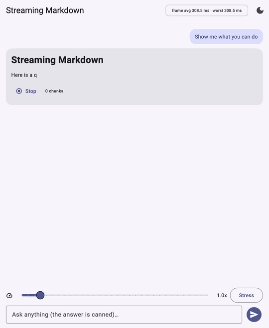

# llm_markdown_renderer

[](https://pub.dev/packages/llm_markdown_renderer)
[](https://pub.dev/packages/llm_markdown_renderer/score)
[](https://pub.dev/packages/llm_markdown_renderer)
[](https://github.com/AshitaNema/llm_markdown_renderer/actions/workflows/ci.yml)
[](https://codecov.io/gh/AshitaNema/llm_markdown_renderer)
[](https://github.com/AshitaNema/llm_markdown_renderer/blob/main/LICENSE)

Render Markdown that is streamed **token by token from an LLM** without jank.

<p align="center">
  
</p>

**[Try the live demo](https://ashitanema.github.io/llm_markdown_renderer/)**

* **Incremental parsing.** Each chunk costs time proportional to the chunk plus
  the *one* block that is still being written. Finished blocks are never parsed
  again and are not rebuilt by Flutter.
* **Stable while streaming.** Unclosed code fences, half-arrived tables, lists
  and dangling `**` render as a sensible preview that does not flicker or
  re-layout as the rest arrives.
* **Syntax-highlighted code blocks** with a language label and a copy button.
  Highlighting is incremental too, so a 5,000-line block stays cheap.
* **Two APIs:** feed a `MarkdownStreamController` with `append(chunk)`, or hand
  the widget a `Stream<String>`.
* **Themeable** through a `ThemeExtension` (`MarkdownTheme`), light and dark.
* **No dependencies** beyond Flutter. Pure Dart, no native code: Android, iOS,
  Web (including WebAssembly), Windows, macOS and Linux.
* **Accessible and international:** semantic headings and lists, per-paragraph
  right-to-left detection (Arabic, Hebrew), large text sizes.
* The parser (`package:llm_markdown_renderer/parser.dart`) imports nothing
  from Flutter, so it runs off the UI thread, in isolates and in Dart scripts.
  The package still depends on the Flutter SDK, so the project using it must
  be built with Flutter installed.

## Install

```sh
flutter pub add llm_markdown_renderer
```

## Quick start

### Controller API

```dart
final controller = MarkdownStreamController();

// as tokens arrive from your model / SSE / websocket:
llmTokens.listen(controller.append, onDone: controller.complete);

// in build():
StreamingMarkdown(controller: controller)
```

Call `controller.reset()` to clear the view (for "regenerate"), and
`controller.dispose()` when you are done. `append` is cheap and can be called
hundreds of times per second: listeners are notified at most once per frame.

### Stream API

```dart
StreamingMarkdown.fromStream(stream: llmTokens)
```

The widget owns the subscription and completes the document when the stream
ends. Keep the `Stream` instance stable across rebuilds; passing a different
one starts over. Handle failures with `onStreamError`.

### Static content

```dart
const StreamingMarkdown.static(data: '# Hello **world**')
```

### Connecting a provider

Recipes for Firebase AI Logic (`firebase_ai`), OpenAI-compatible servers and the
Anthropic API (server-sent events) are in
[doc/integrations.md](https://github.com/AshitaNema/llm_markdown_renderer/blob/main/doc/integrations.md).
Anything that yields text chunks works.

### Links, images, code

```dart
StreamingMarkdown(
  controller: controller,
  onTapLink: (url, title) => launchUrl(Uri.parse(url)), // your choice of plugin
  imageBuilder: (context, url, alt) => Image.network(url), // opt in to images
  highlighter: const CodeHighlighter.defaults(),
)
```

* Links are always styled, but only `http`, `https`, `mailto`, `tel` and
  relative URLs are tappable; `javascript:` and friends are inert. The package
  never launches anything itself.
* Images are **not fetched by default** (model output could point anywhere); an
  alt-text placeholder is shown until you supply an `imageBuilder`.
* Replace the code block with `codeBlockBuilder`, or reuse `CodeBlockView` in
  your own layout. Return `null` from the builder to keep the default view, so
  you can take over only some languages, for example Mermaid diagrams:

  ```dart
  codeBlockBuilder: (context, block) =>
      block.language == 'mermaid' ? MyMermaidView(block.text) : null,
  ```

### Thinking sections and citations

Reasoning models (DeepSeek R1, Qwen, …) start their reply with their chain of
thought in `<think>…</think>`. It is shown as a collapsible "Thinking…"
section that is open while the model thinks and folds to "Thoughts" when the
section closes. Its content is ordinary Markdown, parsed incrementally like
the rest. The tag only counts at the start of the reply, and `</think>` inside
a code block is just code. The header labels are English; pass a
`thinkingBuilder` to localize them.

Citation markers such as `[1]`, `[1, 2]` and `[^note]` look like the original
text until you make them interactive:

```dart
StreamingMarkdown(
  controller: controller,
  onTapCitation: (label) => showSource(label), // labels look like links
  // or take over the look entirely:
  citationBuilder: (context, labels) => SourceChip(labels),
  thinkingBuilder: (context, block, content) => ExpansionTile(
    title: Text(block.isOpen ? 'Thinking…' : 'Thought process'),
    children: [content],
  ),
)
```

* Indexing (`array[1]`, `m[i][0]`), ranges (`[0, 1]`), links (`[1](url)`)
  and definitions (`[1]: url`) are not citations. A partial `[1` is held
  back while streaming, and a complete one waits for the next character, in
  case it turns out to be a link or a definition.
* Turn either off with `MarkdownParserOptions(citations: false)` or
  `MarkdownParserOptions(thinking: false)`.

### LaTeX math

`$…$` and `\(…\)` are parsed as inline math, `$$…$$` as display math, and
`$$` or `\[` alone on a line opens a display math block. The package does not typeset TeX itself, so it takes no math
dependency. Pass a `mathBuilder` with the typesetter of your choice, for
example [`flutter_math_fork`](https://pub.dev/packages/flutter_math_fork):

```dart
StreamingMarkdown(
  controller: controller,
  mathBuilder: (context, tex, display) => Math.tex(
    tex,
    mathStyle: display ? MathStyle.display : MathStyle.text,
    onErrorFallback: (error) => Text(tex),
  ),
)
```

* Without a builder, the TeX source is shown in the code style.
* The builder is only called for **complete** math, so your typesetter never
  sees half-written TeX such as `\frac{a}{`. While streaming, an open math
  block shows its source in a code box; unclosed inline math stays text until
  its closing `$` arrives (except `$\…`, which is shown as source).
* Prices and shell variables are left alone: `$5 and $10`, `$HOME` and
  `echo $$` stay text (Pandoc's rules for `$`), and `\$` is always a literal
  dollar sign. Inside a paragraph `\[` stays an escaped bracket. A `$$` block
  that never closes (by a blank line or the end) is shown as text. Turn math
  off entirely with `MarkdownParserOptions(math: false)`.
* Pass a stable function (a top-level function or a method), not a new
  closure on every build, so finished blocks are not rebuilt.

## How it differs from re-rendering the whole text

The usual way to show a streamed answer is to pass the growing string to a
Markdown widget on every update. That re-parses and re-lays-out the entire
message for every token, so the work per token grows with the length of the
answer, and unfinished syntax flashes in and out: a stray `**`, a code fence
that is not closed yet, a table that looks like text until its second line.

This package is designed around the streaming case instead:

* **Work per chunk does not grow with the message.** Only the block being
  written is parsed again; see the numbers below.
* **A chunking guarantee, enforced by tests.** For every way of splitting the
  input into chunks (down to a single character, splitting fences, `\r\n` pairs
  and emoji), the result equals parsing the input in one go.
* **Finished blocks are never rebuilt.** They are the same objects in every
  snapshot and their widgets are reused by identity.
* **No dependencies.**

## Performance

`benchmark/append_cost.dart` compares what one streamed chunk costs with what
re-parsing the whole text costs, as the document grows (each "block" is a
heading, a paragraph, a list or a code block):

| blocks | text size | incremental, per chunk | full re-parse, per chunk |
|---:|---:|---:|---:|
| 40 | 2 KB | 60 µs | 0.24 ms |
| 400 | 17 KB | 53 µs | 1.0 ms |
| 4,000 | 171 KB | 57 µs | 9.0 ms |
| 40,000 | 1.7 MB | 234 µs | 104 ms |

Measured with `dart run` (JIT) on an Apple M5, Dart 3.13.2. Absolute numbers
will differ on your machine; the shape is what matters. The incremental cost is
flat until the very large documents, where reading the snapshot (a copy of the
list of block references, no parsing) starts to show. These numbers cover the
parser; widget build and layout of the block being written are on top of that,
and finished blocks add nothing.

Reproduce:

```sh
dart run benchmark/append_cost.dart
```

Tips: pass **stable** callbacks and builders to `StreamingMarkdown` (new
closures on every parent build make the configuration look changed and rebuild
finished blocks), and keep `selectable: true` only where you need it.

## Theming

`MarkdownTheme` is a `ThemeExtension`. Without configuration it is derived from
your `ThemeData`; to customise, register it:

```dart
final base = ThemeData(colorSchemeSeed: Colors.teal);
MaterialApp(
  theme: base.copyWith(extensions: [
    MarkdownTheme.fromTheme(base).copyWith(
      blockSpacing: 18,
      codeBlockBorderRadius: 12,
      syntaxTheme: SyntaxTheme.light().copyWith(styles: {
        TokenKind.keyword: const TextStyle(color: Colors.deepPurple),
      }),
    ),
  ]),
);
```

Resolution order: the widget's `theme:` argument, then the `ThemeData`
extension, then a theme derived from the ambient `ThemeData`.

## Syntax highlighting

Built in (pure Dart, rule based, no dependencies): Dart, JavaScript/TypeScript,
JSON, Python, Bash, YAML, SQL, HTML/XML, CSS, C, C++, Java, Kotlin, Swift, Go,
Rust, C#, and diffs, plus common aliases (`js`, `py`, `sh`, `yml`, …). Unknown
languages render as plain monospace.

Add or override a language:

```dart
final highlighter = RuleBasedHighlighter(extraLanguages: [
  LanguageDefinition(name: 'toy', states: {
    'root': [LexRule(r'\bgo\b', TokenKind.keyword)],
  }),
]);
```

or implement the `CodeHighlighter` interface to plug in another engine. The
interface is line-oriented with an opaque carried state, which is what makes
incremental highlighting possible.

## What "stable while streaming" means

| While it is arriving…            | …you see                                                                 |
| -------------------------------- | ------------------------------------------------------------------------ |
| ```` ``` ```` (opening fence)    | a code block shell (header + copy button) as soon as the 3rd backtick lands; a partial ```` `` ```` paints nothing |
| unclosed code fence              | the block, growing append-only; partial closing fence is never painted as code |
| table header only                | a paragraph, until the delimiter row (`\|---\|`) arrives                 |
| partial table row                | a full-width row, missing cells empty; column widths never shrink         |
| `**bold` / `*em` / `` `code ``   | already styled (speculatively closed); a trailing `**` is hidden          |
| `[label](http://ex`              | just the label; it becomes a link when `)` arrives                        |
| `-`, `1.`, `#` alone on a line   | nothing, until there is something to show                                 |
| `<think>` …                      | a "Thinking…" section from the moment the tag is complete; a partial `<thi` paints nothing |
| `[1`                             | nothing, until `]` makes it a citation                                    |

## Using the parser without widgets

`parser.dart` imports nothing from Flutter, so you can parse in an isolate, a
test or a script and render the `MarkdownDocument` however you like. A
project that depends on this package still needs the Flutter SDK installed,
because the package as a whole depends on Flutter.

```dart
import 'package:llm_markdown_renderer/parser.dart';

final parser = IncrementalMarkdownParser();
parser.append('# Hi\n\nSome **bo');
print(parser.document.blocks); // [Heading1(...), Paragraph(...)]
parser.append('ld**');
parser.complete();
```

## Supported Markdown, limitations and FAQ

Supported: ATX/setext headings, paragraphs, emphasis/strong/strikethrough,
inline code, links, images, autolinks, fenced and indented code, block quotes,
nested ordered/unordered lists, task lists, thematic breaks, GFM tables,
LaTeX math (`$…$`, `\(…\)`, `$$…$$`, `\[…\]` blocks), `<think>` sections,
citation markers, backslash escapes and common entities.

**Not supported yet**

* **Reference-style links** (`[text][ref]` with a `[ref]: url` definition).
  They need the whole document, which is at odds with incremental parsing.
* **Raw HTML.** It is never interpreted; it is shown as text (`<think>` is the
  one exception).
* **Footnotes**, definition lists and other extensions.

**Deliberate differences from CommonMark**, to keep every append cheap:

* Tight/loose is decided **per list item**, not per list.
* A block quote is re-parsed as a whole while it is the open block.
* A sub-bullet indented by only 2 spaces under `1.` is treated as nested, as
  most LLMs intend.

**FAQ**

*Does it work with `SelectionArea`?* `StreamingMarkdown` wraps its content in
one by default (`selectable: true`). Set `selectable: false` if you provide your
own.

*Can I render a message that is already complete?* Yes: `StreamingMarkdown.static`.

*Why are my images not showing?* Images are opt-in; see "Links, images, code".

*How do I report a rendering bug?* Open an issue with the Markdown and, if you
can, the chunk sizes you streamed it in. See
[CONTRIBUTING.md](https://github.com/AshitaNema/llm_markdown_renderer/blob/main/CONTRIBUTING.md).

## Example

`example/` is a chat app with a fake LLM that streams canned answers in
irregular 1–12 character chunks (so boundaries fall inside fences, tables and
links), with speed control, light/dark toggle, regenerate, a stress test and a
frame-time readout.

```sh
cd example && flutter run
```

## Architecture

How the parser, the widgets and the guarantees fit together is described in
[ARCHITECTURE.md](https://github.com/AshitaNema/llm_markdown_renderer/blob/main/ARCHITECTURE.md).

## License

MIT, see [LICENSE](https://github.com/AshitaNema/llm_markdown_renderer/blob/main/LICENSE).
